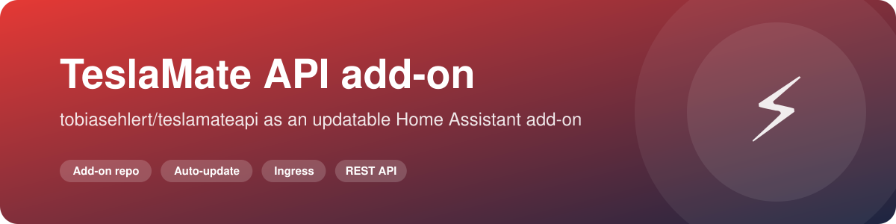
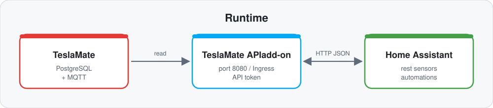
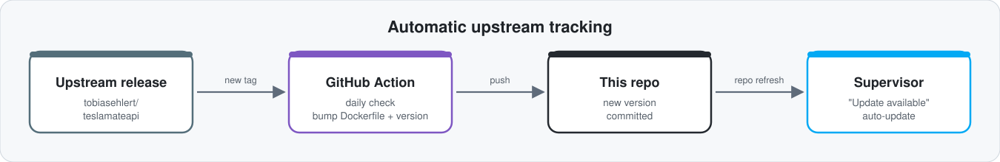

# TeslaMate API Add-on Repository

**English** · [Deutsch](README.de.md)



Home Assistant add-on repository that wraps [tobiasehlert/teslamateapi](https://github.com/tobiasehlert/teslamateapi) as a proper installable and updatable add-on. TeslaMate API provides a REST API (JSON) on top of your [TeslaMate](https://github.com/teslamate-org/teslamate) data – cars, drives, charges, status – which Home Assistant can read with `rest` sensors.



## Why this repo exists

Home Assistant's Supervisor can only detect and offer updates for add-ons that come from a real add-on repository (a git repo with a `repository.yaml` + one folder per add-on). A `local` add-on (built directly on the host under `/addons/local/...`) has no upstream to compare against, so it can never show "update available" – even if the underlying project publishes new releases.

This repo fixes that: it's a minimal add-on repository containing just the `teslamateapi` add-on, pinned to a specific upstream image tag in `teslamateapi/Dockerfile`.

## Staying up to date automatically



[`.github/workflows/check-upstream.yml`](.github/workflows/check-upstream.yml) runs daily, checks the latest release of [tobiasehlert/teslamateapi](https://github.com/tobiasehlert/teslamateapi), and if it's newer than the pinned tag, bumps `teslamateapi/Dockerfile`'s `BUILD_FROM` and `teslamateapi/config.yaml`'s `version` and pushes the commit. Supervisor sees the new version the next time it checks this repo and – with "Auto update" enabled on the add-on – updates itself.

## Setup

1. **Settings → Add-ons → Add-on Store → ⋮ → Repositories** and add `https://github.com/dr-apple/ha-teslamateapi-addon`.
2. Install **TeslaMate API** from the store.
3. Fill in the options (see below) – they are blank in this repo on purpose, since the repo is public.
4. Start the add-on, optionally enable **Auto update** and **Start on boot**.
5. If you previously ran a `local_teslamateapi` add-on: remove it once the new one runs with the same settings.

## Options

| Option | Default | Meaning |
|---|---|---|
| `database_host` / `database_port` | – / `5432` | Hostname of TeslaMate's PostgreSQL |
| `database_user` / `database_pass` / `database_name` | `postgres` / – / `teslamate` | DB credentials |
| `database_ssl` / `database_timeout` | `disable` / `60000` | SSL mode and timeout (ms) |
| `encryption_key` | – | TeslaMate's `ENCRYPTION_KEY` (needed for commands) |
| `mqtt_host` / `mqtt_port` / `mqtt_user` / `mqtt_pass` / `mqtt_tls` | – / `1883` / – / – / `false` | MQTT broker TeslaMate publishes to |
| `mqtt_namespace` | – | Only if TeslaMate uses an MQTT namespace |
| `disable_mqtt` | `false` | Run without MQTT (status endpoint unavailable) |
| `teslamate_host` / `teslamate_port` / `teslamate_ssl` | – / `4000` / `false` | TeslaMate web UI (for links) |
| `timezone` | `Europe/Berlin` | Time zone for the API output |
| `api_token` / `api_token_disable` | – / `false` | Bearer token protecting the API |
| `enable_commands` / `commands_all` | `false` / `false` | Allow vehicle commands via the API (use with care) |
| `debug_mode` | `false` | Verbose logging |

Example:

```yaml
database_host: xxxxxxxx-postgres
database_pass: "your-db-password"
database_name: teslamate
mqtt_host: core-mosquitto
mqtt_user: teslamate
mqtt_pass: "your-mqtt-password"
teslamate_host: 192.168.1.10
api_token: "a-long-random-token"
```

## Using it in Home Assistant

The API listens on port `8080` inside the add-on network (and via Ingress in the sidebar). From Home Assistant use the add-on's hostname, shown on its *Info* page (`xxxxxxxx-teslamateapi`), or map port 8080 in the add-on's *Network* settings and use the host IP. Example `rest` sensor for the battery level of car 1:

```yaml
rest:
  - resource: http://xxxxxxxx-teslamateapi:8080/api/v1/cars/1/status
    headers:
      Authorization: Bearer a-long-random-token
    scan_interval: 60
    sensor:
      - name: Tesla battery level
        value_template: "{{ value_json.data.status.battery_details.battery_level }}"
        unit_of_measurement: "%"
        device_class: battery
```

Check the available endpoints in the [teslamateapi documentation](https://github.com/tobiasehlert/teslamateapi#api-endpoints).

## Notes

- Architecture: `amd64` only (as published upstream image).
- This repo is not affiliated with TeslaMate, TeslaMate API or Tesla.
